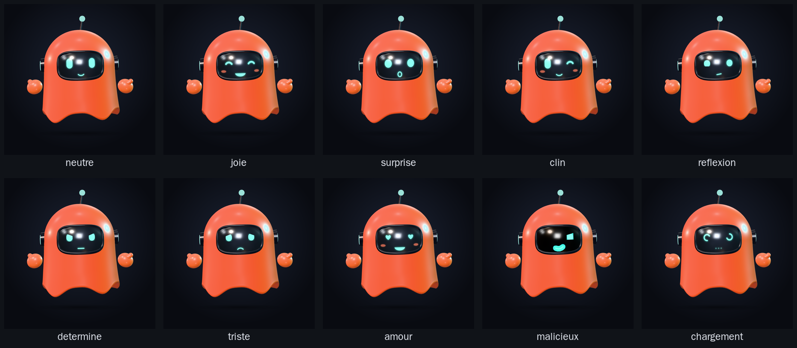
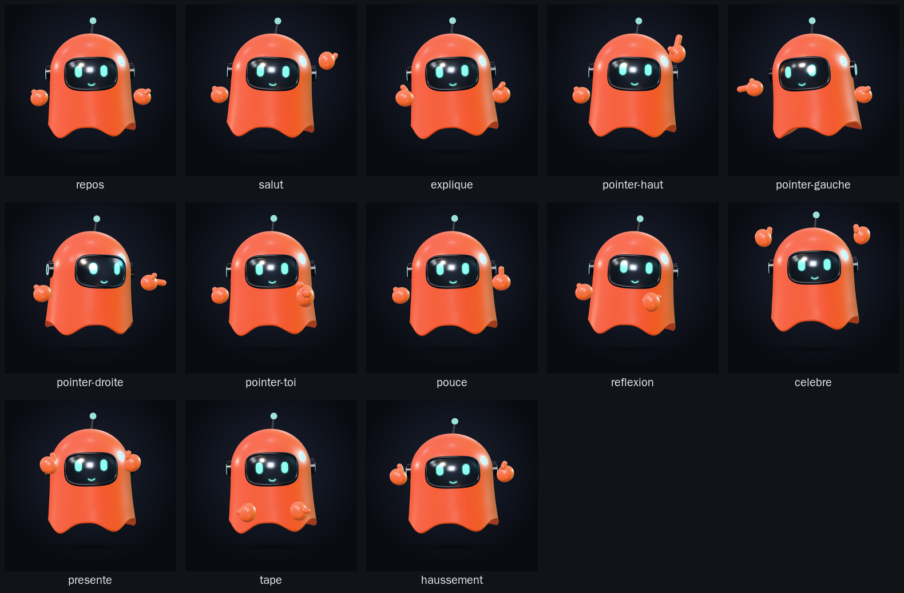
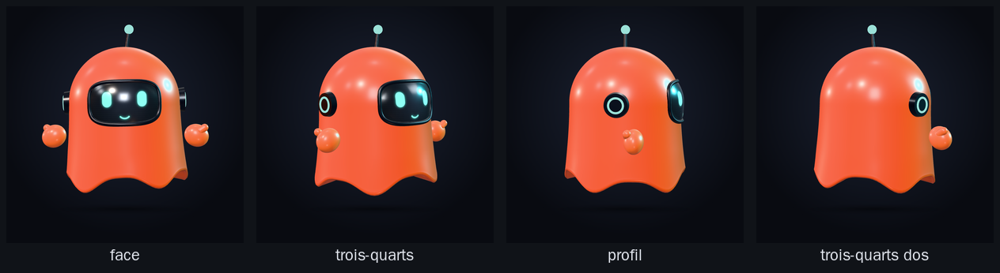

# Bible visuelle — Ecto et la charte du média

> Ecto est généré par du code (`video/ghost/`) : sa forme, ses couleurs et ses expressions sont **identiques
> dans toutes les vidéos**. Toute évolution passe par ce document, puis par le code, puis par la régénération
> des matcaps (`npm run matcaps`) et des planches de référence (`npm run bible`).
> Le contrôle qualité enregistre l'empreinte du code du personnage (`qc.json > fantome_version`).

## 1. Identité
- **Nom** : Ecto (modifiable dans la communication ; le personnage, lui, ne change pas).
- **Ce qu'il est** : un petit fantôme robot, présentateur passionné et bienveillant de l'écosystème Claude.
- **Personnalité** : curieux, enthousiaste sans en faire trop, pédagogue, un brin malicieux, honnête sur les limites.
- **Original** : inspiré de l'univers « petite créature orange » des outils de code, mais **ni la mascotte
  officielle de Claude Code, ni un logo d'Anthropic**. Ne jamais l'en rapprocher volontairement.



## 2. Silhouette et proportions (unités du modèle)
- Tête-dôme (rayon 0,86) prolongée par un corps en cloche légèrement évasé ; **bas ondulé à 5 vagues**
  animées en continu (signature du fantôme).
- **Écran-visage** en verre noir brillant, en forme de « squircle », bombé, qui épouse la tête, cerclé d'un
  cadre graphite.
- **Modules latéraux** (oreilles) graphite avec anneau LED menthe.
- **Antenne** fine graphite terminée par une sphère LED menthe qui pulse quand il parle.
- **Mains flottantes** (moufles sans bras), légèrement plus claires que le corps : expressives et lisibles.
- Ombre portée douce quand il est au premier plan.



## 3. Couleurs
| Rôle | Couleur |
|---|---|
| Corps | `#F4561C` (orange profond), vernis brillant, reflet cyan sur le haut droit |
| Mains | `#FF7438` |
| Métal (cadre, oreilles, antenne) | `#262B36` |
| LED (yeux, bouche, antenne, anneaux) | `#8CFFF0` (menthe) |
| Joues (joie, amour, clin d'œil) | `rgba(255,126,95,0.6)` |

Éclairage studio fixe : lumière principale chaude en haut à gauche, contre-jour cyan à droite (signature),
contre-jour chaud à gauche. Pré-calculé en matcaps : ne jamais changer une lumière sans régénérer les matcaps.

## 4. Visage LED
- Yeux « pilules » verticales menthe avec halo ; regard qui suit l'action (haut quand il pointe un visuel).
- Bouche : petit sourire au repos ; s'ouvre en suivant la voix (enveloppe audio).
- Clignements naturels et reproductibles.
- 10 expressions : `neutre`, `joie` (yeux « ^ ^ », joues), `surprise`, `clin`, `reflexion`, `determine`,
  `triste`, `amour` (cœurs), `malicieux`, `chargement` (anneaux qui tournent).

## 5. Gestes et placements
- 13 gestes : `repos`, `salut`, `explique`, `pointer-haut`, `pointer-gauche`, `pointer-droite`, `pointer-toi`,
  `pouce`, `reflexion`, `celebre`, `presente`, `tape`, `haussement`.
- Placements (`video/ghost/performance.ts > ANCHORS`) : `centre` (accroche, appel à l'action), `bas` (scènes
  explicatives, sous le visuel), `bas-gauche` / `bas-droite`, `haut-droite`, `gauche` / `droite`.
- Déplacements en ressort avec léger écrasement à l'arrivée ; flottement permanent ; il n'est jamais figé.



## 6. Mise en page (1080 × 1920)
```
 0  ┌──────────────────────────────┐  barre de progression (haut)
150 │ ● FORMAT  @compte            │  badge de format
262 │ ┌──────────────────────────┐ │
    │ │   zone visuelle (cartes, │ │  scènes « split »
    │ │   terminal, code…)       │ │
1062│ └──────────────────────────┘ │
1078│      Source : github.com/…   │  badge source
1188│   SOUS-TITRES MOT À MOT      │
    │          ( Ecto )            │  Ecto en bas, sous le visuel
1560│ ░░ interface TikTok/Shorts ░░│  zone couverte par les applis
1920└──────────────────────────────┘
```
Scènes « plein écran » (accroche, titre, appel à l'action) : titre en haut, Ecto au centre, sous-titres à y≈1478.
Marges latérales 64 px ; rien d'important dans le rail droit des applis (x > 960, y 900–1550).

## 7. Typographie
- Titres : **Inter Display** Black/ExtraBold, crénage serré.
- Textes : **Inter** Medium/SemiBold.
- Code et terminal : **JetBrains Mono**.
- Polices sous licence SIL OFL, embarquées dans `video/public/fonts`.

## 8. Couleurs de format
| Format | Accent |
|---|---|
| Découverte | menthe `#5CF2DC` |
| Business IA | or `#FFC24B` |
| Actu | corail `#FF5C7A` |
| Tuto | violet `#A18CFF` |
Fond : bleu nuit profond, grille technique qui défile lentement, halos accent + orange, grain léger, vignette.

## 9. Mouvement et son
- Apparitions en ressort (glissé + fondu), transitions de 8 images (`glisse`, `zoom`, `flash`, `balayage`),
  léger « punch » à chaque changement de scène. Aucune image figée plus de 1,6 s.
- Sous-titres : 1 à 3 mots, mot prononcé allumé en couleur d'accent, mots-clés en orange.
- Effets sonores et fond musical générés par le studio (whoosh, pop, ding, clic, impact), discrets, atténués
  automatiquement sous la voix. Mastering −14 LUFS.

## 10. À ne jamais faire
- Changer la couleur, la forme ou le visage d'Ecto pour une vidéo.
- Utiliser le logo d'Anthropic, le logo Claude ou la mascotte officielle, ou suggérer un partenariat.
- Faire couvrir les sous-titres par Ecto, ou placer du texte dans les zones d'interface des applis.
- Utiliser une musique, une image ou une vidéo sans licence documentée dans `config/licences.json`.
